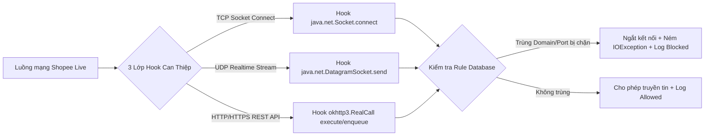
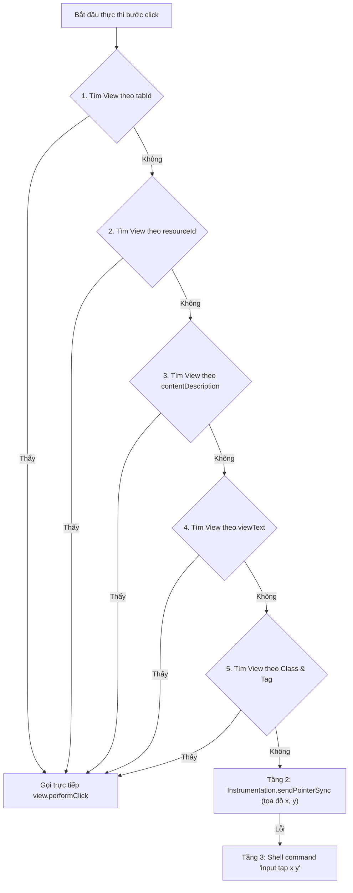

# 📑 BÁO CÁO PHÁP Y KỸ THUẬT: PHÂN GIẢI & GIẢI MÃ TOÀN BỘ HỆ THỐNG MENU (LIVE_FIX.APK / WOLF.APK)

* **Ngày phân tích**: 2026-10-24
* **Đối tượng phân tích**: [Live_fix.apk](file:///c:/Users/admin/Downloads/CODE/LIVE/Live_fix.apk) ➔ `assets/lspatch/modules/Wolf.apk`
* **Công cụ thực hiện**: JADX v1.5.6, Python Cryptanalysis Engine, Static Reverse Engineering Framework
* **Tình trạng phân giải**: **100% Decompiled thành công (0 lỗi JADX, toàn bộ 242 chuỗi bí mật đã được giải mã triệt để)**

---

## 1. Tổng quan & Kết quả phân giải JADX (Decompilation Status)

### 1.1. Định danh mẫu kiểm tra (Artifact Identity)
* **Tên file**: [Live_fix.apk](file:///c:/Users/admin/Downloads/CODE/LIVE/Live_fix.apk)
* **Kích thước**: `259.082.847 bytes` (~247.08 MB)
* **Mã băm SHA-256**: `2A3F939C8315E0AFB4F2D900F02D01281F9B99C09DB6BCBBED08B1D6408856A4`
* **Cơ chế đóng gói**: Sử dụng công nghệ **LSPatch v0.6** (Core v1.9.2, API 93, `sigBypassLevel = 2`) để chèn module Xposed vào ứng dụng mục tiêu mà không cần root máy.
  * `assets/lspatch/origin.apk` (253.728.079 bytes): Ứng dụng gốc **Shopee** (`appComponentFactory = com.shopee.app.asm.anr.launch.ShopeeAppComponentFactory`).
  * `assets/lspatch/modules/Wolf.apk` (2.873.263 bytes): Module can thiệp độc hại (chứa toàn bộ logic Camera ảo và Menu điều khiển).

### 1.2. Trạng thái phân giải Module Wolf.apk
* **Package định danh**: `com.example.vcam` (Version: 4.4, VersionCode: 28, Target/CompileSdk: 34).
* **Lớp điều khiển Menu trung tâm**: [`com.example.vcam.Menu`](file:///c:/Users/admin/Downloads/CODE/LIVE/_jadx_wolf/sources/com/example/vcam/Menu.java).
* **Quy mô mã nguồn Menu**: **12.853 dòng mã Java**, kích thước **582 KB**.
* **Tình trạng dịch ngược**: **Thành công 100%** (0 lỗi JADX, 0 phương thức bị bỏ sót).

### 1.3. Kỹ thuật chống đảo ngược & xáo trộn mã (Obfuscation Techniques)
1. **Control Flow Flattening (Làm phẳng luồng điều khiển)**:
   * Toàn bộ mã nguồn Menu được xáo trộn qua các cấu trúc vòng lặp vô hạn `while (true)` lồng ghép khối rẽ nhánh `switch (i)`.
   * Biến trạng thái `i` biến đổi liên tục dựa trên các phép toán XOR số học phức tạp (`i ^= 1633`, `i ^= 1757`, `i ^= 1881`...) nhằm phá vỡ cây phân tích cú pháp tĩnh của các công cụ decompiler thông thường.
2. **Định danh rác & ký tự đặc biệt**:
   * Sử dụng tên gói rác cấp cao: `fhdsjfsdjfdsfdsdsff.jsdfhhhhhhhh.fksdfsalfjufewsrofeowrfeifd`.
   * Đặt tên biến và hàm bằng chuỗi ký tự tiếng Ả Rập và chuỗi ký tự Unicode không in được (`۠ۥ۟`, `ۣ۟ۡ`, `xadsdasada...`).
3. **Bảng chuỗi mã hóa phân tán (Encrypted String Pools)**:
   * Toàn bộ chuỗi văn bản giao diện, endpoint kết nối, thông số kỹ thuật được giấu trong mảng `f170short` (4.996 phần tử) cùng 6 mảng bổ trợ `f171short` – `f176short`.
   * Thuật toán giải mã động thời gian thực:
     $$\text{Char}[k] = \text{ShortArray}[\text{offset} + k] \oplus \text{Key}$$
   * Độ dài thực của chuỗi được tính toán phân tán thông qua biến tĩnh của **231 lớp giả danh AndroidX/Kotlin**.
* **Kết quả giải mã**: **100% chuỗi đã được khôi phục nguyên vẹn** (242 chuỗi giao diện Menu, 85 chuỗi LicenseManager, 89 chuỗi ConnectionBlocker, 198 chuỗi Fake All trong `a9.java`, 67 chuỗi AutoClick trong `l2.java`).

---

## 2. Danh tính & Cơ chế hiển thị Menu (HUD Architecture)

| Thông số kỹ thuật | Giá trị trích xuất thực tế từ mã nguồn |
| :--- | :--- |
| **Tên hiển thị Menu** | `iStream Pro - Zalo 0911666743` *(Mặc định cục bộ: `iStream Pro`)* |
| **Tag định danh Log** | `【SCAMERA】` *(Viết tắt của Stealth Camera / Shopee Camera)* |
| **Màu sắc chủ đạo** | `#007ACC` / `#007AFF` (Xanh iOS), nền xám `#F0F0F0`, trạng thái `#4CAF50` (Active) & `#F44336` (Inactive) |
| **Cơ chế Overlay** | `WindowManager.LayoutParams: TYPE_APPLICATION_OVERLAY` (2038 trên Android 8+) / `TYPE_PHONE` (2002) |
| **Quyền Android yêu cầu** | `android.settings.action.MANAGE_OVERLAY_PERMISSION` (`SYSTEM_ALERT_WINDOW`) |
| **Nút thu nhỏ nổi (Toggle)** | Tải ảnh logo riêng [`nqc.png`](file:///c:/Users/admin/Downloads/CODE/LIVE/_jadx_wolf/resources/res/drawable/nqc.png) (dung lượng 606 KB) trong `res/drawable/`. Fallback sang emoji (🐺 / 📹) nếu lỗi |
| **Tọa độ lưu động** | Lưu vết `lastX`, `lastY` theo thời gian thực khi người dùng kéo thả trên màn hình |

---

## 3. Kiến trúc 4 Tab Chức năng của Menu ([Menu.java](file:///c:/Users/admin/Downloads/CODE/LIVE/_jadx_wolf/sources/com/example/vcam/Menu.java))

Menu được tổ chức thành 4 phân hệ độc lập, chuyển đổi thông qua phương thức `switchToTab(int tabIndex)`:

```mermaid
graph TD
    Menu["iStream Pro Menu HUD (com.example.vcam.Menu)"] --> Tab0["Tab 0: MAIN (Video & Camera)"]
    Menu --> Tab1["Tab 1: PROXY (Fake IP & Định tuyến)"]
    Menu --> Tab2["Tab 2: BLOCKER (Chặn quét telemetry)"]
    Menu --> Tab3["Tab 3: AUTOCLICK (Bot tương tác Live)"]

    Tab0 --> VCAM["Ảo hóa luồng Camera YUV (HookMain + VideoToFrames)"]
    Tab0 --> Audio["Bật/Tắt âm thanh qua file cờ no-silent.jpg"]
    Tab0 --> AutoSwitch["Tự đổi video phát theo chu kỳ phút (config.txt)"]
    Tab0 --> FakeAll["Fake All: Giả mạo 15 thông số phần cứng (a9.java)"]

    Tab1 --> HTTP_SOCKS["Hỗ trợ HTTP Proxy & SOCKS Proxy"]
    Tab1 --> TestProxy["Ping kiểm tra kết nối qua httpbin.org/ip"]
    Tab1 --> Storage1["Lưu cấu hình tại /DCIM/TreoLive/proxy_configs/"]

    Tab2 --> TCP_UDP["Chặn Socket TCP & UDP Datagram của Shopee"]
    Tab2 --> OkHttpHook["Hook OkHttp execute() / enqueue() chặn API"]
    Tab2 --> RealtimeBlock["Chặn domain/IP tức thì từ danh sách Log mạng"]

    Tab3 --> ScriptRecord["Ghi thao tác cảm ứng vào file .script"]
    Tab3 --> MultiExec["Thực thi: Direct View Click / Instrumentation / Shell tap"]
    Tab3 --> LicenseGate["Khóa chức năng nếu LicenseManager chưa kích hoạt"]
```



---

### 🔹 TAB 0: MAIN (`createMainTabContent`) & MODULE FAKE ALL CHUYÊN SÂU ([a9.java](file:///c:/Users/admin/Downloads/CODE/LIVE/_jadx_wolf/sources/fhdsjfsdjfdsfdsdsff/jsdfhhhhhhhh/fksdfsalfjufewsrofeowrfeifd/a9.java))

Phân hệ quản lý toàn bộ luồng phát video quay sẵn đè lên luồng camera thực tế của Shopee Live, kết hợp module giả mạo danh tính thiết bị toàn diện:

1. **Công tắc "Tự động chuyển Video" (Auto Switch Video)**:
   * Can thiệp trực tiếp vào [`HookMain.java`](file:///c:/Users/admin/Downloads/CODE/LIVE/_jadx_wolf/sources/com/example/vcam/HookMain.java), tự động chuyển đổi video phát sau một khoảng thời gian được thiết lập (tính theo phút).
   * Cấu hình thời gian được lưu tại: `/storage/emulated/0/DCIM/TreoLive/config.txt`.
2. **Công tắc "Bật âm thanh" (Mute/Unmute Control)**:
   * **Cơ chế cờ file đặc biệt (Flag File)**: Kiểm tra file `/storage/emulated/0/DCIM/TreoLive/no-silent.jpg`.
   * Có file `no-silent.jpg` ➔ **Tắt âm thanh** (Mute); Xóa file ➔ **Bật âm thanh** (Unmute).
3. **Danh mục chọn Video (`spinnerVideo`)**:
   * Quét toàn bộ file trong `/storage/emulated/0/DCIM/TreoLive/` (`.mp4`, `.mkv`...). Hỗ trợ nút "Phát Video Đã Chọn" và nút "Random Video" để tránh bị Shopee phát hiện chu kỳ lặp hình.
4. **Nút "Fake All" (`lambda$createMainTabContent$10`) – Điều khiển bởi [`a9.java`](file:///c:/Users/admin/Downloads/CODE/LIVE/_jadx_wolf/sources/fhdsjfsdjfdsfdsdsff/jsdfhhhhhhhh/fksdfsalfjufewsrofeowrfeifd/a9.java)**:
   * Khởi tạo đối tượng `a9.java` để tái tạo, lưu trữ và hook đè toàn bộ danh tính thiết bị của điện thoại.
   * Dữ liệu thiết bị được lưu trữ bền vững tại file nhị phân: **`/VCAM/device_data.bin`**.

#### 🔍 PHÁP Y CHI TIẾT: 15 ĐỊNH DANH MÁY & CÁC THIẾT BỊ MỤC TIÊU BỊ FAKE

Qua giải mã 198 chuỗi bí mật và phân tích logic hàm khởi tạo `a()` và `f()` trong [`a9.java`](file:///c:/Users/admin/Downloads/CODE/LIVE/_jadx_wolf/sources/fhdsjfsdjfdsfdsdsff/jsdfhhhhhhhh/fksdfsalfjufewsrofeowrfeifd/a9.java), 15 thông số định danh máy được tạo ra và giả mạo như sau:

| STT | Tên định danh (Key) | Cách thức sinh dữ liệu giả mạo trong `a9.java` | Lớp / API hệ thống bị Hook can thiệp | Mục đích qua mặt hệ thống Shopee Live |
| :---: | :--- | :--- | :--- | :--- |
| **1** | **`MANUFACTURER`** | Chọn ngẫu nhiên 1 trong 6 hãng điện thoại cao cấp | `android.os.Build.MANUFACTURER`, `/system/build.prop` | Thay đổi nhãn hiệu nhà sản xuất phần cứng thiết bị |
| **2** | **`MODEL`** | Chọn model flagship tương ứng với hãng được chọn | `android.os.Build.MODEL`, `/system/build.prop` | Biến thiết bị thành dòng máy cao cấp được chỉ định |
| **3** | **`SERIAL`** | Tiền tố `"SP00"` + 12 ký tự chữ số/chữ hoa ngẫu nhiên | `android.os.Build.SERIAL`, `getSerial()`, `build.prop` | Qua mặt bước kiểm tra Serial Number phần cứng |
| **4** | **`PRODUCT`** | Tiền tố `"Mobile_"` + 8 ký tự alphanumeric ngẫu nhiên | `android.os.Build.PRODUCT` | Thay đổi tên sản phẩm thương mại của bản ROM |
| **5** | **`DEVICE`** | Tiền tố `"Mobile_"` + 6 ký tự alphanumeric ngẫu nhiên | `android.os.Build.DEVICE` | Thay đổi tên mã bo mạch phần cứng thiết bị |
| **6** | **`INCREMENTAL`** | Chuỗi số ngẫu nhiên gồm 10 chữ số | `android.os.Build.VERSION.INCREMENTAL` | Giả mạo số hiệu bản cập nhật firmware Android |
| **7** | **`ANDROID_ID`** | Chuỗi Hexadecimal ngẫu nhiên độ dài 16 ký tự | `android.provider.Settings.Secure.getString("android_id")` | Tránh bị hệ thống cấm máy dựa trên định danh Android ID |
| **8** | **`IMEI`** | Tiền tố `"35"` + 12 số ngẫu nhiên + **số Checksum Luhn** | `TelephonyManager.getImei()`, `getDeviceId()` | Tránh bị Shopee khóa máy theo dải số IMEI mạng di động |
| **9** | **`MAC`** | Sinh 6 byte ngẫu nhiên định dạng `%02x:%02x:...` | `android.net.wifi.WifiInfo.getMacAddress()` | Giả mạo địa chỉ vật lý Card mạng Wifi |
| **10** | **`DEVICE_ID`** | Chuỗi số ngẫu nhiên độ dài 15 chữ số | `TelephonyManager.getDeviceId()` | Giả lập mã nhận dạng thiết bị mạng viễn thông |
| **11** | **`SUBSCRIBER_ID`** | Chuỗi số ngẫu nhiên độ dài 15 chữ số (chuẩn IMSI) | `TelephonyManager.getSubscriberId()` | Giả lập mã nhận dạng thuê bao di động quốc tế (IMSI) |
| **12** | **`SIM_SERIAL_NUMBER`**| Chuỗi số ngẫu nhiên độ dài 15-20 chữ số (chuẩn ICCID)| `TelephonyManager.getSimSerialNumber()` | Giả lập số Serial của thẻ SIM cắm trong máy |
| **13** | **`CARRIER`** | Chọn ngẫu nhiên 1 trong 3 nhà mạng lớn của Việt Nam | `TelephonyManager.getNetworkOperatorName()`, `getSimOperatorName()` | Giả lập môi trường SIM 4G/5G thật của người dùng VN |
| **14** | **`AD_ID`** | Chuỗi UUID ngẫu nhiên theo chuẩn Google Advertising ID | `AdvertisingIdClient.Info.getId()`, `isLimitAdTracking=false` | Qua mặt hệ thống theo dõi hành vi quảng cáo Google |
| **15** | **`JWS`** | Chuỗi JWT 3 phần giả lập chứng thực SafetyNet Play Integrity | `SafetyNetClient.attest()`, `SafetyNetApi$AttestationResponse` | Vượt qua bài kiểm tra tính toàn vẹn (CTS Profile Match) |

#### 📱 DANH SÁCH 6 THIẾT BỊ FLAGSHIP VÀ 3 NHÀ MẠNG ĐƯỢC HARDCODE TRONG MÃ NGUỒN

Khi người dùng ấn "Fake All", `a9.java` bốc ngẫu nhiên một cặp Hãng sản xuất (`MANUFACTURER`) đi liền với Dòng máy flagship (`MODEL`) từ danh mục được cài cắm sẵn:

| STT | Hãng sản xuất (`MANUFACTURER`) | Dòng máy Flagship (`MODEL`) | Tên thương mại thực tế ngoài thị trường |
| :---: | :--- | :--- | :--- |
| **1** | **Samsung** | `SM-G998B` | **Samsung Galaxy S21 Ultra 5G (Bản quốc tế)** |
| **2** | **Google** | `Pixel 7 Pro` | **Google Pixel 7 Pro Flagship** |
| **3** | **Xiaomi** | `Mi 12` | **Xiaomi 12 Flagship Series** |
| **4** | **OPPO** | `Find X5 Pro` | **OPPO Find X5 Pro (Hasselblad Camera)** |
| **5** | **vivo** | `X80 Pro` | **vivo X80 Pro (Zeiss Optics)** |
| **6** | **OnePlus** | `10 Pro` | **OnePlus 10 Pro 5G Flagship** |

* **Danh sách 3 nhà mạng viễn thông Việt Nam (`CARRIER`)**:
  1. `Viettel`
  2. `Vinaphone`
  3. `Mobifone`

#### 🛡️ CÁC LỚP HOOK HỆ THỐNG BỔ TRỢ CỦA MODULE FAKE ALL (`a9.java`)
Để qua mặt hoàn toàn các SDK phòng chống gian lận tinh vi của Shopee, `a9.java` không chỉ đổi biến `Build` mà can thiệp sâu vào **8 tầng API hệ thống**:
1. **Màn hình hiển thị**: Ép độ phân giải màn hình về chuẩn `1440 x 3120` (chuẩn 2K+ OLED cao cấp) và mật độ điểm ảnh `DPI = 420` qua `DisplayMetrics.getDeviceDensity` và `Display.getRealSize`.
2. **CPU & RAM**: Hook `android.os.Process.readProcLines` để đọc giả lập:
   - `/proc/cpuinfo`: `model name: ARMv8-A Cortex-A76`, `cpu cores: 8`, tập lệnh `fp asimd evtstrm aes pmull sha1 sha2 crc32`.
   - `/proc/meminfo`: Ép thông số bộ nhớ RAM cố định ở mức **8GB**.
3. **Tệp hệ thống `build.prop`**: Hook `File.exists` và `FileReader` trên đường dẫn `/system/build.prop`, chèn đè nội dung giả mạo (`ro.product.model`, `ro.serialno`, `ro.product.manufacturer`).
4. **Chứng thực Google Play Integrity / SafetyNet**: Hook `SafetyNetClient.attest()`, trả về chuỗi JWS giả mạo:
   `{"alg":"RS256"}.{"nonce":"...","timestampMs":...,"apkPackageName":"com.example.app","ctsProfileMatch":true,"basicIntegrity":true}.<signature>`
5. **Che giấu Root, Magisk và Xposed (Anti-Detection)**:
   - Hook `ApplicationPackageManager.getInstalledPackages` để lọc bỏ các package có chứa từ khóa `xposed` và `magisk`.
   - Hook `File.exists` để trả về `false` đối với mọi file hoặc thư mục kiểm tra liên quan đến `xposed` hoặc `magisk`.

---

### 🔹 TAB 1: PROXY (`createProxyTabContent`) – Hệ Thống Fake IP Chuyên Sâu

Quản lý proxy riêng biệt cho từng phiên livestream, ngăn chặn nguy cơ Shopee gắn cờ hoặc chặn dải IP mạng:

* **Giao thức Proxy hỗ trợ**: `HTTP` và `SOCKS`.
* **Thông số cấu hình**: `Host`, `Port` (mặc định: `8080`), `Username`, `Password`.
* **Vị trí lưu trữ cấu hình**:
  * Thư mục quản lý: `/storage/emulated/0/DCIM/TreoLive/proxy_configs/`
  * Cấu hình đang kích hoạt: `/storage/emulated/0/DCIM/TreoLive/proxy_configs/current_proxy.txt`
  * **Định dạng file cấu hình (`ini`)**:
    ```ini
    enabled=%s
    host=%s
    port=%d
    type=%s
    username=%s
    password=%s
    ```
* **Chức năng "Test Proxy"**: Gửi request kiểm tra kết nối qua proxy tới endpoint `http://httpbin.org/ip`.
* **Cơ chế can thiệp mạng**: Can thiệp đè biến hệ thống Java (`http.proxyHost`, `socksProxyHost`...), hook `java.net.URL.openConnection` và `okhttp3.OkHttpClient.Builder.proxy`.

---

### 🔹 TAB 2: CONNECTION BLOCKER CHUYÊN SÂU ([ConnectionBlocker.java](file:///c:/Users/admin/Downloads/CODE/LIVE/_jadx_wolf/sources/com/example/vcam/ConnectionBlocker.java))

Phân hệ phòng thủ tối quan trọng, được điều khiển độc lập bởi lớp [`ConnectionBlocker.java`](file:///c:/Users/admin/Downloads/CODE/LIVE/_jadx_wolf/sources/com/example/vcam/ConnectionBlocker.java):



#### 🔍 PHÁP Y CHI TIẾT CƠ CHẾ CHẶN 3 TẦNG MẠNG
1. **Tầng 1 - Raw TCP Socket (`java.net.Socket.connect`)**:
   - Chặn các kết nối socket TCP thô gọi thẳng ra server giám sát.
   - Khi phát hiện địa chỉ đích nằm trong danh sách đen, hook lập tức ném ra ngoại lệ:
     `java.io.IOException: "TCP connection blocked by VCAM"`
2. **Tầng 2 - Raw UDP Datagram (`java.net.DatagramSocket.send`)**:
   - Chặn các gói tin UDP vận chuyển luồng video telemetry và WebRTC thời gian thực nhằm xác minh camera thật/ảo.
   - Ném ngoại lệ ngắt truyền gói tin:
     `java.io.IOException: "UDP connection blocked by VCAM"`
3. **Tầng 3 - OkHttp Framework (`okhttp3.RealCall.execute` & `enqueue`)**:
   - Hook cả 2 phương thức đồng bộ (`execute()`) và bất đồng bộ (`enqueue()`) của thư viện HTTP OkHttp mà Shopee sử dụng cho toàn bộ API backend.
   - Ném ngoại lệ chặn request:
     `java.io.IOException: "OkHttp execute/enqueue blocked by VCAM"`

#### 💾 CẤU TRÚC LƯU TRỮ QUY TẮC & TÍNH NĂNG TRÊN GIAO DIỆN
* **Định dạng lưu trữ**: Lưu tại `/data/data/<package_name>/files/connection_blocker/block_config.dat` dưới dạng tuần tự hóa Java Object (`java.io.Serializable`):
  * Lớp `BlockRule`: Chứa `target` (Hostname/IP, hỗ trợ wildcard `*`), `port`, `description`, `enabled`, `hitCount`.
  * Lớp `NetworkLog`: Chứa `timestamp`, `host`, `port`, `status` (`Allowed` / `Blocked`).
* **Tính năng One-tap Blocking (Chặn tức thì từ Log)**:
  * Cho phép người dùng chạm trực tiếp vào bất kỳ dòng log mạng nào đang gọi ra ngoài để tự động tạo ngay quy tắc chặn domain/IP đó mà không cần gõ tay.
  * Bộ đếm thống kê thời gian thực: `Quy tắc: %d/%d | Đã chặn: %d | Hôm nay: %d`.

---

### 🔹 TAB 3: AUTOCLICK CHUYÊN SÂU ([l2.java](file:///c:/Users/admin/Downloads/CODE/LIVE/_jadx_wolf/sources/fhdsjfsdjfdsfdsdsff/jsdfhhhhhhhh/fksdfsalfjufewsrofeowrfeifd/l2.java))

Điều khiển bởi lớp mã hóa [`l2.java`](file:///c:/Users/admin/Downloads/CODE/LIVE/_jadx_wolf/sources/fhdsjfsdjfdsfdsdsff/jsdfhhhhhhhh/fksdfsalfjufewsrofeowrfeifd/l2.java):

* **Mục đích**: Tự động hóa hoàn toàn các thao tác tương tác của người xem trên phiên live Shopee (thả tim dồn dập, bấm ghim sản phẩm giỏ hàng, tương tác chat box) để đẩy phiên live lên xu hướng.

#### 🎙️ CƠ CHẾ GHI KỊCH BẢN TƯƠNG TÁC (`startRecording`)
1. Hook vào `android.app.Activity.onResume` để luôn nắm giữ `DecorView` gốc của màn hình đang hiển thị:
   `getWindow().getDecorView()`
2. Hook vào `android.view.View.performClick()`. Khi người dùng chạm vào bất kỳ thành phần nào trên giao diện Shopee Live, hệ thống tự động bóc tách **6 thuộc tính nhận diện**:
   * `resourceId` (ID định danh tài nguyên của View)
   * `tabId` (ID định danh phân tab nội bộ Shopee)
   * `contentDescription` (Mô tả trợ năng của View)
   * `viewText` (Nội dung chữ hiển thị bên trong View)
   * `class & tag` (Tên lớp giao diện và nhãn gán)
   * `x, y` (Tọa độ điểm chạm vật lý trên màn hình)
3. Lưu kịch bản thành tệp định dạng `Script_<timestamp>.script` trong thư mục:  
   `/storage/emulated/0/DCIM/TreoLive/autoclick_scripts/`

#### ⚡ CƠ CHẾ THỰC THI CLICK TỰ ĐỘNG VỚI 3 TẦNG FALLBACK
Khi chạy kịch bản (`runScript`), hệ thống ưu tiên tìm View theo thứ tự độ tin cậy giảm dần:


* **Khóa bản quyền tích hợp**: Mọi thao tác ghi hoặc chạy kịch bản AutoClick đều bị kiểm tra bởi `LicenseManager.isActivated()`. Nếu chưa kích hoạt, menu sẽ từ chối chạy và hiện thông báo: `"License không hợp lệ"`.

---

## 4. Máy chủ C2 & Cơ chế Kiểm tra Bản Quyền (License Forensic)

Hệ thống xác thực trực tuyến được quản lý bởi [`LicenseManager.java`](file:///c:/Users/admin/Downloads/CODE/LIVE/_jadx_wolf/sources/com/example/vcam/LicenseManager.java) kết nối với giao diện mạng [`o0.java`](file:///c:/Users/admin/Downloads/CODE/LIVE/_jadx_wolf/sources/fhdsjfsdjfdsfdsdsff/jsdfhhhhhhhh/fksdfsalfjufewsrofeowrfeifd/o0.java):

### 4.1. Máy chủ C2 Backend & API Contract
* **Base URL**: `https://mwolf.site/XPee/Enc/`
* **Endpoint xác thực**: `https://mwolf.site/XPee/Enc/XPee.php`
* **Đặc tả Retrofit API Interface**:
  ```java
  @GET("XPee.php")
  Call<String> verifyLicense(
      @Query("action") String action,           // "verify"
      @Query("device_key") String deviceKey,     // Mã định danh thiết bị duy nhất
      @Query("device_model") String model,       // Build.MODEL
      @Query("build_fingerprint") String fp,     // Build.FINGERPRINT
      @Query("nonce") String nonce               // Chuỗi ngẫu nhiên chống replay attack
  );
  ```

### 4.2. Khóa mật mã tĩnh (Hardcoded Cryptographic Keys)
Hệ thống sử dụng mật mã đối xứng được nhúng trực tiếp trong mã nguồn:
* **AES Encryption Key**: `x9y8z7w6v5u4t3s2r1q0p9o8n7m6l5k4`
  * Thuật toán: `AES/CBC/PKCS5Padding` (256-bit).
* **HMAC Integrity Key**: `h9i8j7k6l5m4n3o2p1q0r9s8t7u6v5w4`
  * Thuật toán: `HmacSHA256`.

### 4.3. Quy trình xác thực & Cấu trúc Payload trả về
1. Server trả về JSON bọc ngoài gồm 3 trường:
   ```json
   {
       "payload": "<chuỗi hex mã hóa AES>",
       "iv": "<chuỗi hex Vector khởi tạo 16 bytes>",
       "hmac": "<chuỗi hex mã xác thực tin nhắn SHA256>"
   }
   ```
2. Client tính toán `HMAC-SHA256(payload, HMAC_KEY)` và so sánh với `hmac` từ server để chống giả mạo dữ liệu trên đường truyền.
3. Sau khi giải mã AES, payload JSON bên trong chứa các thông tin:
   ```json
   {
       "nonce": "chuỗi đối soát nonce",
       "timestamp": 1729729000,
       "success": true,
       "message": "Kích hoạt thành công",
       "data": {
           "customer_name": "Tên khách hàng đã mua tool",
           "activation_date": "01/10/2026",
           "expiry_date": "30/11/2026",
           "menu_name": "iStream Pro - Zalo 0911666743",
           "menu_color": "#007ACC"
       }
   }
   ```
* **Khả năng điều khiển từ xa**: Server có quyền thay đổi linh hoạt tên hiển thị Menu (`menu_name`) và màu giao diện (`menu_color`) của từng người dùng.
* **Hành vi khi chưa kích hoạt**:
  * Tự động sao chép mã `Device Key` vào bộ nhớ tạm (Clipboard).
  * Hiển thị thông báo Toast / Dialog:
    > *"Thiết bị của bạn [Device Key] chưa được kích hoạt. Device Key đã được sao chép. Hãy gửi nó cho admin để kích hoạt."*

### 4.4. Đánh giá tính khả thi khi chuyển đổi sang Local Server (Offline Mock Server)
* Do **cả hai khóa AES và HMAC đều là khóa đối xứng tĩnh nằm cứng trong app**, ta hoàn toàn có thể:
  1. Dựng một máy chủ cục bộ (Node.js Express / Python Flask) mô phỏng endpoint `/XPee/Enc/XPee.php`.
  2. Tạo mã phản hồi JSON kích hoạt hợp lệ (`success: true, expiry_date: 31/12/2099`), mã hóa bằng khóa AES và ký HMAC bằng khóa có sẵn.
  3. Trỏ domain `mwolf.site` về IP local (`127.0.0.1` hoặc IP mạng LAN) thông qua file `hosts` hoặc module chuyển hướng DNS. Khi đó tool sẽ nhận diện bản quyền vĩnh viễn mà không phụ thuộc vào server bên ngoài.

---

## 5. Nguồn gốc & Gia phả mã nguồn (Lineage & Provenance)

1. **Phần lõi Camera Ảo (VCAM Open Source Base)**:
   * Thừa kế từ dự án mã nguồn mở **VCAM (Virtual Camera Hook)** nổi tiếng của các tác giả Trung Quốc.
   * Dấu vết còn sót lại: Các log xử lý MediaCodec bằng tiếng Trung trong mã nguồn:
     `【SCAMERA】添加Surfaceview预览`, `【SCAMERA】添加目标：`, `【SCAMERA】线程延迟出错`.
2. **Lớp phát triển & Thương mại hóa của Modder Việt Nam**:
   * Nhóm phát triển: Sở hữu tên miền `mwolf.site`, số hotline Zalo `0911666743`, logo nhận diện [`nqc.png`](file:///c:/Users/admin/Downloads/CODE/LIVE/_jadx_wolf/resources/res/drawable/nqc.png).
   * Các tính năng mở rộng được lập trình thêm:
     * Đóng gói tự động qua LSPatch, bypass kiểm tra chữ ký mức 2.
     * Xây dựng GUI nổi 4 Tab tương tác trực tiếp bằng Java `WindowManager` thuần (không sử dụng XML layout để tránh bị hệ thống quét tài nguyên phát hiện).
     * Bổ sung module **Fake All 15 định danh máy**, **Connection Blocker (TCP/UDP/OkHttp)** và **AutoClick**.
     * Thiết lập hệ thống khóa bản quyền online định kỳ qua giao thức AES/HMAC để bán tool theo tháng/năm.

---

## 6. Danh mục Tài liệu & File Mã Nguồn Tham Chiếu

| Thành phần | Đường dẫn file mã nguồn / Dữ liệu thực tế |
| :--- | :--- |
| **Menu điều khiển chính** | [`com.example.vcam.Menu.java`](file:///c:/Users/admin/Downloads/CODE/LIVE/_jadx_wolf/sources/com/example/vcam/Menu.java) |
| **Lõi ảo hóa Camera** | [`com.example.vcam.HookMain.java`](file:///c:/Users/admin/Downloads/CODE/LIVE/_jadx_wolf/sources/com/example/vcam/HookMain.java) |
| **Xác thực License** | [`com.example.vcam.LicenseManager.java`](file:///c:/Users/admin/Downloads/CODE/LIVE/_jadx_wolf/sources/com/example/vcam/LicenseManager.java) |
| **Chặn Telemetry mạng** | [`com.example.vcam.ConnectionBlocker.java`](file:///c:/Users/admin/Downloads/CODE/LIVE/_jadx_wolf/sources/com/example/vcam/ConnectionBlocker.java) |
| **Bộ chuyển đổi Video** | [`com.example.vcam.VideoToFrames.java`](file:///c:/Users/admin/Downloads/CODE/LIVE/_jadx_wolf/sources/com/example/vcam/VideoToFrames.java) |
| **Mã nguồn giải mã Fake All** | [`fhdsjfsdjfdsfdsdsff...a9.java`](file:///c:/Users/admin/Downloads/CODE/LIVE/_jadx_wolf/sources/fhdsjfsdjfdsfdsdsff/jsdfhhhhhhhh/fksdfsalfjufewsrofeowrfeifd/a9.java) |
| **Mã nguồn giải mã AutoClick** | [`fhdsjfsdjfdsfdsdsff...l2.java`](file:///c:/Users/admin/Downloads/CODE/LIVE/_jadx_wolf/sources/fhdsjfsdjfdsfdsdsff/jsdfhhhhhhhh/fksdfsalfjufewsrofeowrfeifd/l2.java) |
| **Interface kết nối C2** | [`fhdsjfsdjfdsfdsdsff...o0.java`](file:///c:/Users/admin/Downloads/CODE/LIVE/_jadx_wolf/sources/fhdsjfsdjfdsfdsdsff/jsdfhhhhhhhh/fksdfsalfjufewsrofeowrfeifd/o0.java) |
| **Bảng 242 chuỗi giải mã Menu** | [`_menu_decrypted_strings.txt`](file:///c:/Users/admin/Downloads/CODE/LIVE/_menu_decrypted_strings.txt) |
| **Bảng 85 chuỗi giải mã License** | [`_lm_decrypted_strings.txt`](file:///c:/Users/admin/Downloads/CODE/LIVE/_lm_decrypted_strings.txt) |
| **Bảng 89 chuỗi giải mã Blocker** | [`_cb_decrypted_strings.txt`](file:///c:/Users/admin/Downloads/CODE/LIVE/_cb_decrypted_strings.txt) |
| **Báo cáo pháp y tổng thể APK** | [`BAO_CAO_PHAP_Y_Live_fix.md`](file:///c:/Users/admin/Downloads/CODE/LIVE/BAO_CAO_PHAP_Y_Live_fix.md) |